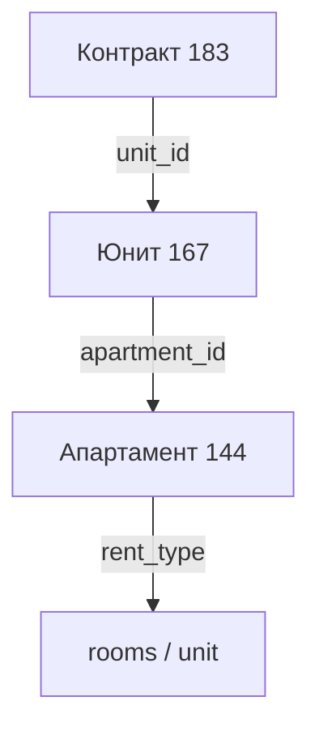
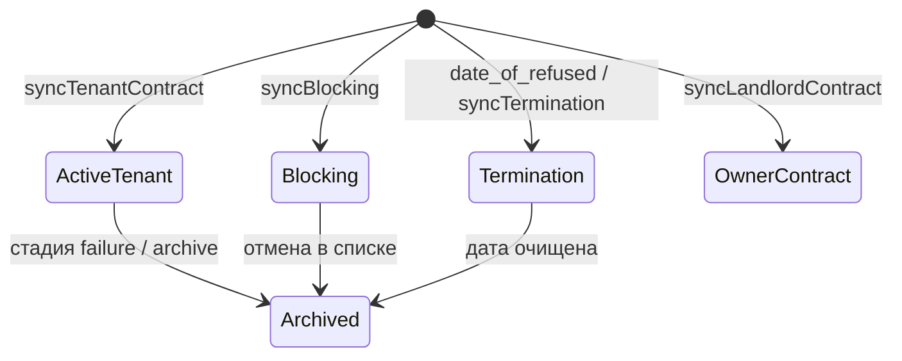
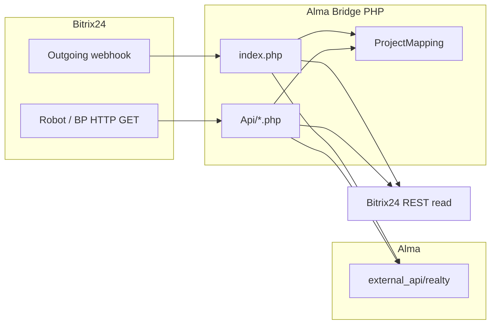
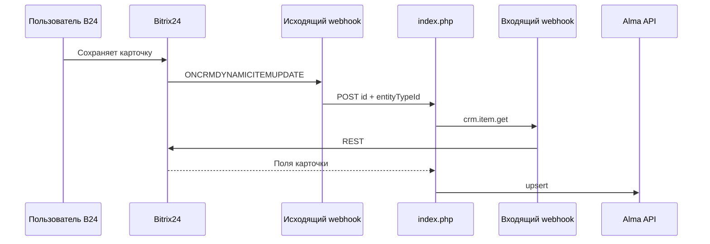
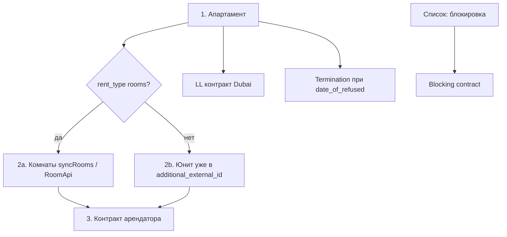

# Alma ↔ Bitrix24 Bridge

Интеграционный PHP‑проект: синхронизация недвижимости между **Bitrix24** (операционная CRM: смарт‑процессы, контакты, списки) и **Alma** (система управления арендой: здания, апартаменты, комнаты, контракты, жильцы). Bridge не хранит свою БД — он **читает** актуальные данные из Bitrix24 и **создаёт/обновляет** объекты в Alma через External API.

**Роль bridge в экосистеме:** Bitrix24 остаётся источником правды для карточек объектов и документов; Alma — для мобильного приложения жильцов, биллинга периодов аренды и учёта использования юнитов. Любое изменение в B24 (вручную или по роботу) должно попасть в Alma, иначе жилец видит устаревшие данные.

## Содержание

- [О продукте](#о-продукте)
- [Предметная область](#предметная-область)
- [Сценарии синхронизации](#сценарии-синхронизации)
- [Шеринг и идентификаторы](#шеринг-и-идентификаторы)
- [Контракты и специальные типы](#контракты-и-специальные-типы)
- [Клиенты (арендаторы и собственники)](#клиенты-арендаторы-и-собственники)
- [Быстрый старт](#быстрый-старт)
- [Как это работает](#как-это-работает)
- [Стек и требования](#стек-и-требования)
- [Структура проекта](#структура-проекта)
- [Конфигурация](#конфигурация)
- [Развёртывание](#развёртывание)
- [Интеграция с Bitrix24](#интеграция-с-bitrix24)
- [Проверка данных в Bitrix24 через webhook](#проверка-данных-в-bitrix24-через-webhook)
- [Проекты Dubai и HongKong](#проекты-dubai-и-hongkong)
- [Эндпоинты](#эндпоинты)
- [Порядок синхронизации](#порядок-синхронизации)
- [Alma API](#alma-api)
- [Проверка и отладка](#проверка-и-отладка)
- [Логи и обслуживание](#логи-и-обслуживание)
- [Типичные ошибки Alma](#типичные-ошибки-alma)
- [Связанная документация](#связанная-документация)
- [Соглашения по коду](#соглашения-по-коду)

---

## О продукте

### Зачем нужен bridge

Colife (и аналогичные операторы) ведут портфель недвижимости в Bitrix24: апартаменты, комнаты в шеринговых квартирах, договоры аренды, блокировки, расторжения. Alma даёт жильцам личный кабинет и фиксирует **периоды использования** юнита (tenant contract / usage). Без bridge данные в двух системах расходятся.

Bridge решает:

| Задача | Как |
|--------|-----|
| Создать апартамент в Alma при появлении в B24 | `syncApartment` |
| Синхронизировать комнаты шерингового апартамента | `AppartApi::syncRooms` или `RoomApi.php` |
| Перенести договор арендатора с датами и суммой | `syncTenantContract` |
| Перенести договор с собственником (LL) | `syncLandlordContract` (Dubai) |
| Заблокировать юнит на период (ремонт, собственник) | `syncBlocking` из списка B24 |
| Отразить расторжение / отказ | `syncTermination`, `syncTerminationForApt` |

### Что bridge не делает

- Не синхронизирует изменения **из Alma обратно** в Bitrix24 (односторонний поток B24 → Alma).
- Не обрабатывает контакты CRM напрямую через webhook (события контактов игнорируются в `index.php`; клиент создаётся **внутри** синхронизации контракта).
- Не использует SQL‑базу (`DB_*` в example не читается кодом).
- Не гарантирует доставку при падении Alma — ошибка пишется в лог; повтор зависит от повторного события B24 или ручного GET.

### Два региона — один код

| Проект | Портал Bitrix24 | Особенности |
|--------|-----------------|-------------|
| **Dubai** | colifeae.bitrix24.eu (типично) | Полный набор: LL‑контракты, блокировки из полей апартамента/юнита, юниты через робот, не через webhook |
| **HongKong** | colifepacific (типично) | Другие `entityTypeId`, юниты синхронизируются через webhook, связь юнит↔апартамент через другое поле |

Выбор проекта — автоматически в webhook или параметр `project` в GET.

---

## Предметная область

### Иерархия в Alma

```text
Проект (логический, Dubai/HongKong)
  └── Здание (Building) — создаётся/находится по имени из B24
        └── Апартамент / Unit (realty/units) — объект аренды
              └── Комната (room) — только при rent_type = rooms (шеринг)
                    └── Usage / Tenant contract — период проживания арендатора
```

В API Alma апартамент и «полный юнит» (не шеринг) — одна сущность `units` с разными флагами `external_id` / `additional_external_id` / `is_used_additional_external_id`.

### Сущности в Bitrix24 (Dubai, пример)

```text
Апартамент (entityTypeId 144)
  ├── rent_type: rooms | unit  (поле ufCrm6_1736951470242)
  ├── стадия для Alma (Available / Rented / Blocked / Ex…)
  └── поля: адрес, этаж, Wi‑Fi, парковка, photos…

Юнит / комната (entityTypeId 167)
  ├── ссылка на апартамент (ufCrm8_1684429208)
  └── площадь, целевая аренда, номер комнаты

Контракт арендатора (entityTypeId 183)
  ├── ссылка на юнит (ufCrm20_1693919019)
  ├── тип контракта (Airbnb, Ejari, Long-term…)
  ├── даты заезда/выезда
  └── контакт арендатора (contactId)

Контракт собственника (entityTypeId 148) — только Dubai
  ├── апартамент, собственник, work model, сканы документов

Списки (lists) — блокировки и расторжения
  └── элемент списка → служебный tenant contract в Alma
```

Цепочка для контракта арендатора:



Ключевые поля Dubai (коды в [`ProjectMapping.php`](Core/Config/ProjectMapping.php)):

| Назначение | Поле B24 (Dubai) |
|------------|------------------|
| Тип аренды апартамента | `ufCrm6_1736951470242` |
| Юнит в контракте | `ufCrm20_1693919019` |
| Апартамент в юните | `ufCrm8_1684429208` |
| Тип контракта | `ufCrm20_1693561495` |
| Дата отказа / расторжение | `ufCrm6_1742377926` |
| Email для Alma | `UF_CRM_1727788747` |

Полная матрица полей для аналитиков: [Documentation/fields.md](Documentation/fields.md).

---

## Сценарии синхронизации

Каждый сценарий — PHP‑функция + опциональный HTTP entry point в `Api/`.

### 1. Апартамент — `syncApartment` ([`AppartApi.php`](Api/AppartApi.php))

**Триггеры:** webhook на `entityTypeId` апартамента; GET `/Api/AppartApi.php?id=…`.

**Алгоритм:**

1. `crm.item.get` — карточка апартамента из Bitrix24.
2. Проверка **стадии** (`stage`):
   - стадия из `archive_stage_ids` → архивация юнита в Alma (`setUnitArchived`), попытка архивировать пустое здание;
   - стадия не из `allowed_stage_ids` → синхронизация пропускается (объект не «активен» для Alma).
3. Определение **rent_type** (`rooms` / `unit`) по справочнику B24.
4. `getOrCreateBuilding` — здание в Alma по названию из B24.
5. Сбор payload: адрес, тип, спальни, метро, Wi‑Fi, парковка, `goal_rent_cost`, флаги `external_id` / `additional_external_id` / `is_used_additional_external_id` (см. [шеринг](#шеринг-и-идентификаторы)).
6. `upsertApartment` — POST или PATCH в `realty/units/`.
7. **Каскад:**
   - если `rent_type = rooms` → `syncRooms()` — все дочерние юниты апартамента;
   - если задано поле `date_of_refused` → `syncTerminationForApt()` — служебный контракт расторжения.

**Результат в Alma:** запись `units` с `property_type` apartment/studio и корректными external id для последующего поиска `rental_object`.

### 2. Комната / юнит — `RoomApi.php` / `syncUnitById` ([`RoomApi.php`](Api/RoomApi.php), [`UnitApi.php`](Api/UnitApi.php))

**Триггеры:**

- Dubai: GET `/Api/RoomApi.php` (робот); webhook на юнит **не** обрабатывается.
- HongKong: webhook на `entityTypeId` юнита → `syncUnitById`.

**Алгоритм (`RoomApi`):**

1. `crm.item.get` юнита.
2. Из юнита — ID апартамента (поле зависит от проекта).
3. `crm.item.get` апартамента → проверка `rent_type` (для шеринга нужен `rooms`).
4. Поиск родительского апартамента в Alma по `external_id` апартамента → `parent_unit`.
5. `upsertRoom` — POST/PATCH `realty/rooms/` с `property_type: room`, `number`, `goal_rent_cost`, `internal_area`.

**Важно:** комната всегда имеет `external_id` = ID **юнита** в B24, не апартамента.

### 3. Контракт арендатора — `syncTenantContract` ([`TenantContractApi.php`](Api/TenantContractApi.php))

**Триггеры:** webhook на контракт; GET `/Api/TenantContractApi.php?id=…`.

**Алгоритм:**

1. `crm.item.get` контракта + `crm.contact.get` арендатора.
2. Маппинг типа контракта B24 → Alma (`contract_type_mapping`); неизвестный тип → ошибка.
3. Проверка стадии: контракты в архивных стадиях → **архивация** usage в Alma, не обновление.
4. Цепочка: `unit_id` → юнит → апартамент → `rent_type`.
5. `findAlmaObjectById` / `rental_object` — найти целевой unit/room в Alma (логика приоритетов — см. [шеринг](#шеринг-и-идентификаторы)).
6. `ensureClientExists` — создать или найти клиента Alma по `external_id` = ID контакта B24.
7. Проверка даты расторжения апартамента: `end_date` контракта не позже `date_of_refused`.
8. `createContract` или `updateContract` → `realty/contracts/tenant_contracts/`.

Типы контрактов Dubai (синхронизируются):

| ID B24 | Тип в Alma |
|--------|------------|
| 882 | Airbnb |
| 8672 | Ejari |
| 884 | Short term from 1 to 3 months |
| 886 | Long-term 3+ months |
| 1304 | Booking |
| 1306 | Short contract up to 1 month |
| 6578 | Less than a month |
| 0000 | Blocking |
| 0002 | Termination |

Для Airbnb/Ejari приглашение в Alma может не отправляться (`no_invitation_contract_type_ids`).

### 4. Контракт собственника — `syncLandlordContract` ([`LandlordContractApi.php`](Api/LandlordContractApi.php))

**Только Dubai** (`entityTypeId` 148).

1. Чтение смарт‑процесса LL‑контракта.
2. Создание/обновление клиента‑собственника в Alma.
3. Поиск апартамента в Alma по `external_id` апартамента B24.
4. POST/PATCH `realty/contracts/owner_contracts/` (даты, work model, сканы Title Deed / PML / DTCM).

HongKong: `landlord_contract_entity_type_id` не задан — сценарий не вызывается из webhook.

### 5. Блокировка — `syncBlocking` ([`BlockingAppartApi.php`](Api/BlockingAppartApi.php))

**Источник:** элемент **универсального списка** Bitrix24 (не смарт‑процесс).

1. `lists.element.get` по ID элемента.
2. Фильтры: тип события «Блокировка», объект = Apartment, есть дата начала.
3. Причина блокировки → фиксированный `client_id` в Alma (служебный «клиент» причины: ремонт, собственник живёт и т.д.).
4. `upsertSyntheticContract` — tenant contract типа Blocking на период start–end (по умолчанию end до 2030-12-31, если не указан).
5. Статус «отменено» в списке → архивация контракта в Alma.

Параметр `debug=1` — вернуть собранный payload без записи.

### 6. Расторжение — `syncTermination` / `syncTerminationForApt` ([`TerminationAppartApi.php`](Api/TerminationAppartApi.php))

**Два входа:**

| Вход | Когда |
|------|--------|
| `syncTerminationForApt` | автоматически после `syncApartment`, если заполнено поле `date_of_refused` |
| `syncTermination` | GET по ID элемента списка с типом «Расторжение» |

Создаётся служебный tenant contract:

- `external_id`: `termination_{apartment_bitrix_id}`
- тип Termination (`0002`)
- фиксированный `termination_alma_client_id` из маппинга
- период: дата отказа → +5 дней

Если дата отказа очищена — существующий termination‑контракт **архивируется**.

---

## Шеринг и идентификаторы

Критичная для продукта логика: от неё зависит, к какому объекту в Alma привяжется контракт.

### Два режима аренды апартамента

| rent_type в B24 | Значение enum (Dubai) | Смысл |
|-----------------|----------------------|--------|
| `rooms` | 4600 | Шеринг: апартамент целиком в Alma, комнаты сдаются по отдельности |
| `unit` | 4598 | Целиком: один юнит = апартамент + привязанный unit в B24 |

### Как записывается объект в Alma

**Шеринг (`rooms`):**

| Объект | external_id | additional_external_id | is_used_additional_external_id | parent_unit |
|--------|-------------|------------------------|-------------------------------|-------------|
| Апартамент | ID апартамента B24 | `""` | `false` | — |
| Комната | ID юнита B24 | — | — | ID апартамента **в Alma** |

**Целиком (`unit`):**

| Объект | external_id | additional_external_id | is_used_additional_external_id |
|--------|-------------|------------------------|--------------------------------|
| Апартамент | ID апартамента B24 | ID юнита B24 | `true` |

### Поиск `rental_object`

При синхронизации контракта Alma ищет объект по Bitrix ID:

```http
GET /external_api/realty/rental_object/{bitrix_id}/
```

Приоритет результатов (упрощённо):

| Приоритет | Что найдено |
|-----------|-------------|
| 3 (высший) | Полный юнит: `additional_external_id` совпал, `is_used_additional_external_id = true` |
| 2 | Комната с `parent_unit` |
| 1 | Обычный апартамент/юнит |
| 0 | Полный юнит по основному `external_id` |

**Типичная ошибка:** комната создана с `external_id` = ID апартамента → апартамент не находится, контракт падает. Исправление: у комнаты `external_id` = ID юнита B24, `parent_unit` = Alma ID апартамента.

Подробнее: [Documentation/logic.md](Documentation/logic.md).

### Пример цепочки (шеринг)

```text
Контракт 6222 → unit_id 62 → apartment_id 14 → rent_type rooms
→ в Alma ищем room с external_id "62"
→ контракт привязывается к room id 2376, parent_unit 15477
```

### Пример (не шеринг)

```text
Контракт 8331 → unit_id 88 → apartment_id 15 → rent_type unit
→ в Alma ищем apartment external_id "15" (с additional_external_id "88")
```

---

## Контракты и специальные типы



| Тип | external_id в Alma | Клиент | Объект |
|-----|---------------------|--------|--------|
| Обычный арендатор | ID контракта B24 | контакт B24 | room или unit по rent_type |
| Blocking | ID элемента списка | служебный по причине | apartment |
| Termination | `termination_{apt_id}` | `termination_alma_client_id` | apartment |
| Owner (LL) | ID LL‑контракта B24 | собственник | apartment |

**Пересечение дат:** Alma не позволит два активных usage на одном юните с пересекающимися датами — см. [типичные ошибки](#типичные-ошибки-alma).

**Архивация:** при переводе контракта B24 в архивную стадию (`tenant_contract_archive_stage_ids` / `failure_stage_id`) bridge вызывает archive в Alma вместо PATCH.

---

## Клиенты (арендаторы и собственники)

Класс [`ClientApi.php`](Api/ClientApi.php):

1. `GET users/clients/external_id/{bitrix_contact_id}/` — клиент уже есть?
2. Если нет — `POST users/clients/` с `first_name`, `last_name`, `email`, `phone`, `external_id`.
3. Флаг `is_send_password_when_creating` — отправка приглашения (для части типов контрактов отключён).

**Требования Alma:**

- обязателен `last_name`;
- уникальный `email` (конфликт, если email занят сотрудником или другим клиентом);
- `external_id` должен совпадать с ID контакта B24 — иначе повторная синхронизация не «подхватит» вручную созданного клиента.

Поля контакта в маппинге: `tenant_fields`, `landlord_fields` в `ProjectMapping`.

---

## Быстрый старт

1. **PHP 8.0+** с расширениями `curl`, `json` (рекомендуется `mbstring`, `openssl`).
2. Скопируйте шаблон конфигурации:
   ```bash
   cp config.env.example config.env
   ```
3. Заполните в `config.env` минимум:
   - `ALMA_API_KEY`, `ALMA_API_URL`
   - `PROJECT_DUBAI_WEBHOOK_URL` (и при необходимости `PROJECT_HONGKONG_WEBHOOK_URL`)
4. Убедитесь, что PHP может **читать** `config.env` и **писать** в `logs/` (каталог создаётся автоматически).
5. Настройте виртуальный хост на **корень репозитория** (document root = папка с `index.php`).
6. Проверьте ручной вызов (подставьте реальный ID из Bitrix24):
   ```bash
   curl "https://your-domain.com/Api/AppartApi.php?id=123&project=Dubai"
   ```
7. В Bitrix24:
   - **исходящий webhook** → `https://your-domain.com/index.php`
   - **роботы/БП** → GET на нужный скрипт в `Api/` (см. [Интеграция с Bitrix24](#интеграция-с-bitrix24))

Composer не используется. Переменные `DB_*` в `config.env.example` в текущем коде **не читаются** — зарезервированы на будущее.

---

## Как это работает



### Три способа запуска синхронизации

| Способ | Точка входа | Когда использовать |
|--------|-------------|-------------------|
| Автоматически | [`index.php`](index.php) | Bitrix24 шлёт событие при изменении смарт‑процесса |
| Вручную из робота/БП | [`Api/*.php`](Api/) | Точечная синхронизация по ID документа |
| Каскад | внутри `syncApartment` | После апартамента вызывается `AppartApi::syncRooms()` для дочерних юнитов |

### Роутер webhook (`index.php`)

Bitrix24 передаёт данные в `$_REQUEST` (часто `application/x-www-form-urlencoded`, не только JSON). Роутер:

1. Определяет **проект** (`Dubai` / `HongKong`).
2. По `entityTypeId` (и имени события) выбирает сценарий.
3. Читает сущность из Bitrix24 через входящий webhook URL проекта и пишет в Alma.

**Выбор проекта** (`HongKong`, если выполняется любое из условий):

- в `HTTP_HOST` есть подстрока `PROJECT_HONGKONG_DOMAIN` (по умолчанию `colifepacific`);
- событие сделки (`ONCRMDEALADD` / `ONCRMDEALUPDATE`) с `typeId = 2`;
- `entityTypeId` ∈ {1054, 1058, 1072}.

Иначе — `Dubai`.

**Маршрутизация по типу сущности** (после определения проекта):

| Условие | Действие |
|---------|----------|
| `entityTypeId` = апартамент проекта | `syncApartment` |
| `entityTypeId` = юнит, проект **HongKong** | `syncUnitById` |
| `entityTypeId` = юнит, проект **Dubai** | игнор (выход без синхронизации) |
| `typeId === 3` или событие контакта | игнор |
| `entityTypeId` = контракт арендатора | `syncTenantContract` |
| `entityTypeId` = контракт собственника (Dubai) | `syncLandlordContract` |

Имена событий настраиваются в `config.env`: `BITRIX_EVENT_*`.

---

## Стек и требования

- **PHP 8.0+**, веб‑сервер Nginx или Apache
- Расширения: `curl`, `json`; рекомендуется `mbstring`, `openssl`
- Доступ к **Bitrix24** (входящий REST webhook на чтение CRM)
- Доступ к **Alma External API** (`ALMA_API_KEY`, `ALMA_API_URL`)
- Composer **не требуется**

---

## Структура проекта

```
alma/
├── index.php              # webhook-роутер Bitrix24
├── config.env             # секреты (не в git)
├── config.env.example     # шаблон
├── Api/                   # сценарии синхронизации + HTTP entry points
│   ├── BaseApi.php        # HTTP-клиент Alma, JSON-ответы
│   ├── AppartApi.php      # апартаменты
│   ├── RoomApi.php        # комнаты/юниты (GET entry)
│   ├── UnitApi.php        # класс работы с юнитами в Alma
│   ├── ClientApi.php      # клиенты Alma
│   ├── TenantContractApi.php
│   ├── LandlordContractApi.php
│   ├── BlockingAppartApi.php
│   ├── TerminationAppartApi.php
│   └── ListSyncHelpers.php
├── Core/
│   ├── Bitrix24Rest.php   # REST Bitrix24
│   ├── Logger.php         # логи + ActionLogger-классы
│   ├── Logger.php
│   └── Config/
│       ├── Config.php
│       └── ProjectMapping.php
├── Documentation/         # углублённая документация
├── scripts/cron.sh        # очистка старых логов
└── logs/                  # журналы (создаётся автоматически)
```

---

## Конфигурация

### `config.env`

Создайте из [`config.env.example`](config.env.example). Основные переменные:

| Переменная | Назначение |
|------------|------------|
| `ALMA_API_KEY` | ключ Alma External API |
| `ALMA_API_URL` | базовый URL API, например `https://…/external_api/` |
| `PROJECT_DEFAULT_NAME` | проект по умолчанию (`Dubai`) |
| `PROJECT_DUBAI_WEBHOOK_URL` | входящий webhook Bitrix24 для Dubai |
| `PROJECT_HONGKONG_WEBHOOK_URL` | входящий webhook для HongKong |
| `PROJECT_HONGKONG_DOMAIN` | подстрока в домене запроса для выбора HongKong |
| `BITRIX_EVENT_*` | имена событий исходящего webhook |

### `ProjectMapping`

Класс [`Core/Config/ProjectMapping.php`](Core/Config/ProjectMapping.php) хранит для каждого проекта:

- `entityTypeId` смарт‑процессов (апартамент, юнит, контракты);
- коды пользовательских полей Bitrix24;
- маппинги справочников (тип контракта, стадия, rent_type и т.д.).

В HTTP‑запросах к `Api/*.php` проект задаётся параметром `project` (по умолчанию `Dubai`). В webhook проект определяется автоматически (см. [роутер](#роутер-webhook-indexphp)).

---

## Развёртывание

1. Клонируйте репозиторий в каталог, обслуживаемый веб‑сервером:
   ```bash
   git clone <repo-url> /var/www/alma
   ```
2. `cp config.env.example config.env` и заполните ключи.
3. Права: чтение `config.env`, запись в `logs/`.
4. Виртуальный хост: document root = корень проекта, PHP обрабатывает `.php`.
5. Ограничьте доступ к URL снаружи (см. [Безопасность](#безопасность) в разделе логов).

Пример проверки синтаксиса после правок:

```bash
php -l index.php
php -l Api/AppartApi.php
```

---

## Интеграция с Bitrix24

### Входящий webhook (для `index.php`)

1. Bitrix24 → **Разработчикам → Вебхуки** → создайте **входящий** webhook с правами CRM.
2. URL webhook пропишите в `config.env` как `PROJECT_<NAME>_WEBHOOK_URL` (bridge **читает** Bitrix24 через этот URL).

### Исходящий webhook (события → bridge)

1. Bitrix24 → исходящий webhook / подписка на события CRM.
2. URL обработчика:
   ```text
   https://your-domain.com/index.php
   ```
3. Рекомендуемые события (имена в `config.env`):
   - `ONCRMDYNAMICITEMUPDATE` — изменения смарт‑процессов;
   - при необходимости `ONCRMDEALADD`, `ONCRMDEALUPDATE`.

Данные приходят в `$_REQUEST['event']`, `$_REQUEST['data']['FIELDS']` и т.д.

Пример структуры (упрощённо) для `ONCRMDYNAMICITEMUPDATE`:

```text
event=ONCRMDYNAMICITEMUPDATE
data[FIELDS][ID]=12345
data[FIELDS][ENTITY_TYPE_ID]=144
```

Роутер извлекает `ID` и `ENTITY_TYPE_ID`, определяет проект и вызывает нужный `sync*`. Если `ID` отсутствует — запись в лог `Webhook: missing entity ID` и выход.

### Роботы и бизнес‑процессы (ручной вызов)

HTTP **GET** на скрипт в `Api/` с параметрами `id` и `project`.

**Комната / юнит (Dubai):**

```text
https://your-domain.com/Api/RoomApi.php?id={=Document:ID}&project=Dubai
```

**Апартамент:**

```text
https://your-domain.com/Api/AppartApi.php?id={=Document:ID}&project=Dubai
```

**Контракт арендатора:**

```text
https://your-domain.com/Api/TenantContractApi.php?id={=Document:ID}&project=Dubai
```

**Блокировка / расторжение** — параметр `id` это ID **элемента списка** Bitrix24, не смарт‑процесса:

```text
https://your-domain.com/Api/BlockingAppartApi.php?id={=Document:ID}&project=Dubai
https://your-domain.com/Api/BlockingAppartApi.php?id={=Document:ID}&project=Dubai&debug=1
https://your-domain.com/Api/TerminationAppartApi.php?id={=Document:ID}&project=Dubai
```

`debug=1` у блокировки возвращает payload без записи в Alma.

При срабатывании робота скрипт: читает сущность через `crm.item.get` (или список), маппит поля по `ProjectMapping`, создаёт или обновляет объект в Alma.

---

## Проверка данных в Bitrix24 через webhook

В интеграции участвуют **два разных webhook** — их часто путают.

| Webhook | Где создаётся | Куда прописан | Зачем |
|---------|---------------|---------------|-------|
| **Входящий** (incoming) | B24 → Разработчикам → Вебхуки → Входящий | `PROJECT_*_WEBHOOK_URL` в `config.env` | Bridge **читает** карточки: `crm.item.get`, `crm.contact.get`, `lists.element.get` |
| **Исходящий** (outgoing) | B24 → Разработчикам → Вебхуки → Исходящий (или обработчик событий) | URL на стороне bridge: `https://<domain>/index.php` | B24 **шлёт событие** при изменении CRM; bridge по `ID` снова читает данные **входящим** webhook |



Исходящий webhook **не отдаёт** полную карточку — только идентификаторы. Поэтому проверка «что увидит bridge» всегда делается через **входящий** webhook (те же запросы, что делает код).

### 1. Проверить входящий webhook (чтение карточек)

Скопируйте URL из `config.env` (`PROJECT_DUBAI_WEBHOOK_URL`). Формат:

```text
https://<portal>.bitrix24.eu/rest/<user_id>/<secret>/
```

В конце URL должен быть один слэш. Подставьте `B24_WEBHOOK` в команды ниже.

#### Одна карточка — `crm.item.get`

**Dubai** (`entityTypeId` из [таблицы](#id-смартпроцессов-entitytypeid)):

```bash
B24_WEBHOOK="https://your-portal.bitrix24.eu/rest/1/xxxxxxxx/"

# Апартамент (144)
curl -s "${B24_WEBHOOK}crm.item.get?entityTypeId=144&id=14" | jq .

# Юнит / комната (167)
curl -s "${B24_WEBHOOK}crm.item.get?entityTypeId=167&id=62" | jq .

# Контракт арендатора (183)
curl -s "${B24_WEBHOOK}crm.item.get?entityTypeId=183&id=6222" | jq .

# Контракт собственника (148)
curl -s "${B24_WEBHOOK}crm.item.get?entityTypeId=148&id=LL_ID" | jq .
```

**HongKong** — те же методы, другие ID: `1054`, `1058`, `1072`.

Успешный ответ содержит `result.item` с полями `id`, `title`, `ufCrm…`. Если `error` — проверьте права webhook (CRM, смарт‑процессы) и что ID существует.

#### Контакт арендатора — `crm.contact.get`

Нужен для контрактов (`contactId` в карточке контракта):

```bash
curl -s "${B24_WEBHOOK}crm.contact.get?id=CONTACT_ID" | jq .
```

Проверьте: `NAME`, `LAST_NAME`, `EMAIL`, `PHONE` — без фамилии Alma отклонит клиента.

#### Список — `lists.element.get` (блокировка / расторжение)

Dubai: список с `blocking_list_iblock_id` = **300** (см. `ProjectMapping`).

```bash
curl -s -G "${B24_WEBHOOK}lists.element.get" \
  --data-urlencode "IBLOCK_TYPE_ID=lists" \
  --data-urlencode "IBLOCK_ID=300" \
  --data-urlencode "ELEMENT_ID=LIST_ELEMENT_ID" | jq .
```

#### Несколько карточек — `crm.item.list`

GET (простой список):

```bash
curl -s "${B24_WEBHOOK}crm.item.list?entityTypeId=183&start=0&limit=10" | jq .
```

POST с фильтром (тип контракта, юнит):

```bash
curl -s -X POST "${B24_WEBHOOK}crm.item.list" \
  -d "entityTypeId=183" \
  -d "filter[ufCrm20_1693919019]=62" \
  -d "start=0" \
  -d "limit=50" | jq .
```

Пагинация: `start=0`, затем `start=50` при `next` в ответе.

#### Что сверить с `ProjectMapping`

После `crm.item.get` найдите в `result.item` коды полей из [`ProjectMapping.php`](Core/Config/ProjectMapping.php):

| Проверка | Поле в ответе B24 (Dubai) |
|----------|---------------------------|
| Тип аренды | `ufCrm6_1736951470242` (4600=rooms, 4598=unit) |
| Юнит в контракте | `ufCrm20_1693919019` |
| Апартамент в юните | `ufCrm8_1684429208` |
| Тип контракта | `ufCrm20_1693561495` |
| Стадия апартамента | `ufCrm6_1742486676` |

Если поле пустое в B24 — bridge отправит в Alma пустое/дефолт и синхронизация может упасть.

### 2. Проверить исходящий webhook (события → bridge)

#### Настройка в Bitrix24

1. **Разработчикам** → **Другое** → **Исходящий вебхук** (или **Обработчики событий** / локальное приложение).
2. URL обработчика: `https://<ваш-домен>/index.php`
3. События (как в `config.env`):
   - `ONCRMDYNAMICITEMUPDATE` — обязательно для смарт‑процессов;
   - `ONCRMDEALADD`, `ONCRMDEALUPDATE` — если нужны сделки (HongKong);
   - `ONCRMCONTACTUPDATE` — в bridge **игнорируется**, подключать не обязательно.

Права исходящего webhook: CRM, смарт‑процессы (как минимум те сущности, которые синхронизируете).

#### Проверка, что B24 отправляет событие

1. Сохраните карточку апартамента/контракта в B24.
2. В интерфейсе B24 (если доступно): журнал исходящих webhook / лог приложения — статус **успех** или код ответа `200` от вашего сервера.
3. На сервере bridge — лог за проект и час:
   ```bash
   tail -f logs/dubai/$(date -u +%Y-%m-%d)/$(date -u +%H).log
   ```
   Ожидаемые записи: вызов `syncApartment` / `syncTenantContract` или `Webhook: missing entity ID` / `apartment sync failed`.

Если в B24 «успех», а в Alma пусто — смотрите `_error.log` и [типичные ошибки](#типичные-ошибки-alma).

#### Симуляция исходящего webhook вручную

Проверить `index.php` без сохранения в B24 (подставьте реальные `ID` и `ENTITY_TYPE_ID`):

```bash
curl -s -X POST "https://your-domain.com/index.php" \
  -d "event=ONCRMDYNAMICITEMUPDATE" \
  -d "data[FIELDS][ID]=14" \
  -d "data[FIELDS][ENTITY_TYPE_ID]=144"
```

Для Dubai юнит (167) через этот путь **не синхронизируется** — роутер выходит без действий; используйте `RoomApi.php`.

#### Типичные проблемы исходящего webhook

| Симптом | Причина | Что сделать |
|---------|---------|-------------|
| B24: ошибка доставки | URL недоступен, SSL, 500 на сервере | `curl -v` на `index.php`, логи PHP/nginx |
| Событие есть, Alma не обновилась | Ошибка после чтения B24 | `_error.log`, ручной `Api/*.php?id=` |
| Юнит Dubai не синхронизируется | По дизайну webhook игнорирует 167 | Робот на `RoomApi.php` |
| Неверный проект HongKong | Домен запроса | `PROJECT_HONGKONG_DOMAIN` в `config.env` |
| `missing entity ID` | B24 прислал событие без `data[FIELDS][ID]` | Формат события, другой тип handler |

### 3. Сквозная проверка «B24 → bridge → Alma»

Чеклист для одного контракта:

1. **B24 входящий:** `crm.item.get` контракта → есть `ufCrm20_1693919019` (unit_id).
2. **B24 входящий:** `crm.item.get` юнита → есть связь с апартаментом.
3. **B24 входящий:** `crm.item.get` апартамента → `rent_type` корректен.
4. **Alma:** `GET .../realty/rental_object/{unit_id}/` — объект найден.
5. **Bridge:** `curl .../Api/TenantContractApi.php?id=CONTRACT_ID&project=Dubai` — `success: true`.
6. **Alma:** `GET .../tenant_contracts/external_id/CONTRACT_ID/` — контракт создан.
7. **Исходящий:** изменить поле контракта в B24 → в логе bridge новая запись без ошибки.

### 4. Где смотреть в интерфейсе Bitrix24

| Что | Где в B24 |
|-----|-----------|
| URL входящего webhook | Разработчикам → Вебхуки → входящий → скопировать REST URL |
| Исходящий webhook | Разработчикам → Исходящий вебхук / Обработчики событий |
| ID смарт‑процесса | URL карточки: `.../type/144/` → **144** = `entityTypeId` |
| ID элемента списка | Карточка элемента списка (блокировка) → ID в URL или свойствах |
| Поля карточки | Настройки смарт‑процесса → Поля → код `ufCrm…` |
| Контакт контракта | Вкладка контракта → клиент → ID в URL `crm/contact/details/ID/` |

Порталы Dubai / HongKong — **разные** входящие webhook URL в `config.env`.

---

## Проекты Dubai и HongKong

Один codebase, разные порталы Bitrix24 и маппинги в `ProjectMapping`.

### ID смарт‑процессов (`entityTypeId`)

| Сущность | Dubai | HongKong |
|----------|-------|----------|
| Апартамент | 144 | 1054 |
| Юнит / комната | 167 | 1058 |
| Контракт арендатора | 183 | 1072 |
| Контракт собственника | 148 | — |

### Поведенческие отличия

| Аспект | Dubai | HongKong |
|--------|-------|----------|
| Webhook на юнит | игнорируется | `syncUnitById` |
| Связь юнит ↔ апартамент | поле `ufCrm8_1684429208` | поле `ufCrm13Apartments` |
| Список юнитов апартамента | через CRM-фильтр | из поля апартамента |

Подробнее про шеринг (`rent_type` rooms/unit) и поиск `rental_object` — в [Documentation/logic.md](Documentation/logic.md).

---

## Эндпоинты

Все скрипты в `Api/` отдают JSON через `BaseApi::sendSuccessResponse` / `sendErrorResponse`.

### `index.php` — webhook Bitrix24

- Метод: обычно **POST** (данные в `$_REQUEST`).
- Не требует query-параметров `id` / `project` — ID и тип берутся из тела события.
- См. [маршрутизацию](#роутер-webhook-indexphp).

### `Api/*.php` — ручная синхронизация (GET)

| URL | Параметры | Назначение |
|-----|-----------|------------|
| `/Api/AppartApi.php` | `id`, `project?`, `entity_type_id?` | апартамент |
| `/Api/RoomApi.php` | `id`, `project?` | комната / юнит |
| `/Api/TenantContractApi.php` | `id`, `project?` | контракт арендатора |
| `/Api/LandlordContractApi.php` | `id`, `project?` | контракт собственника |
| `/Api/BlockingAppartApi.php` | `id`, `project?`, `debug?` | блокировка из списка |
| `/Api/TerminationAppartApi.php` | `id`, `project?` | расторжение из списка |

`project` по умолчанию: `Dubai`.

### Примеры ответов

Успех:

```json
{
  "success": true,
  "code": 200,
  "response": { "id": 456, "external_id": "123", "name": "Room 123" },
  "method": "POST"
}
```

Ошибка:

```json
{
  "success": false,
  "code": 400,
  "response": { "message": "Validation error: Apartment ID not found in room" },
  "method": "ERROR"
}
```

---

## Порядок синхронизации

Рекомендуемая последовательность (зависимости Alma). Нарушение порядка — главная причина ошибок 404 и «object not found».



| Шаг | Действие | Зависит от |
|-----|----------|------------|
| 1 | `syncApartment` | — |
| 2 | `RoomApi` / `syncRooms` / HK webhook юнита | апартамент в Alma |
| 3 | `syncTenantContract` | room или unit в Alma; контакт с email и фамилией |
| 4 | `syncLandlordContract` | апартамент в Alma (Dubai) |
| 5 | `syncBlocking` | апартамент; элемент списка; причина в маппинге |
| 6 | `syncTermination` | апартамент; дата отказа или элемент списка |

**Практика для нового объекта в B24:**

1. Создали апартамент → дождаться webhook/вызвать `AppartApi.php`.
2. Для шеринга — создали юниты → `RoomApi.php` на каждый (или дождаться `syncRooms` из п.1).
3. Создали контракт → `TenantContractApi.php` или webhook.

**Стадии апартамента:** синхронизация в Alma идёт только для стадий из `allowed_stage_ids` (например Available, Rented). Ex / Blocked в архивных — объект архивируется в Alma, а не обновляется.

---

## Alma API

Запросы к Alma:

- заголовок `Api-Key: <ALMA_API_KEY>`
- `Content-Type: application/json`, `Accept: application/json`
- тело — JSON

Postman-коллекция (на сервере, не в git): `Documentation/Colife Alma.postman_collection.json`.  
Полный текстовый справочник: [Documentation/integration.txt](Documentation/integration.txt).

Пример payload комнаты (`RoomApi.php` → `UnitApi::upsertRoom`):

```json
{
  "external_id": "123",
  "name": "Room 123",
  "header": "Room 123",
  "goal_rent_cost": 4500,
  "internal_area": 15.5,
  "photos": [],
  "property_type": "room",
  "number": "1",
  "parent_unit": 987
}
```

- `external_id` — ID юнита в Bitrix24;
- `parent_unit` — внутренний ID апартамента в Alma;
- даты — `YYYY-MM-DDT00:00:00Z`.

### Endpoint Alma (как в Postman + что использует bridge)

| Операция | Метод | Путь |
|----------|-------|------|
| Клиенты — список | GET | `users/clients/` |
| Клиент — по id | GET | `users/clients/{id}/` |
| Клиент — создать | POST | `users/clients/` |
| Клиент — обновить | PATCH | `users/clients/{id}/` |
| Клиент — по external_id | GET | `users/clients/external_id/{id}/` |
| Юниты — список | GET | `realty/units/` |
| Юнит — по id | GET | `realty/units/{id}/` |
| Юнит — создать/обновить | POST/PATCH | `realty/units/`, `realty/units/{id}/` |
| Юнит — по external_id | GET | `realty/units/external_id/{id}/` |
| Комнаты — список | GET | `realty/rooms/` |
| Комната — по id | GET | `realty/rooms/{id}/` |
| Комната — создать/обновить | POST/PATCH | `realty/rooms/`, `realty/rooms/{id}/` |
| Комната — по external_id | GET | `realty/rooms/external_id/{id}/` |
| Tenant contracts — список | GET | `realty/contracts/tenant_contracts/` |
| Tenant contract — по id | GET | `realty/contracts/tenant_contracts/{id}/` |
| Tenant contract — создать/обновить | POST/PATCH | `realty/contracts/tenant_contracts/` |
| Owner contract | POST/PATCH/GET | `realty/contracts/owner_contracts/`, `…/external_id/{id}/` |
| Поиск объекта для контракта | GET | `realty/rental_object/{bitrix_id}/` |
| Здание | GET/POST | `realty/buildings/` |
| Загрузка файла | POST | `external-image/` (multipart `image`) |

В Postman сейчас есть GET/PATCH для clients, units, rooms и GET tenant_contracts; create юнитов/комнат, owner_contracts, `rental_object` и `external-image` в коллекции нет — ими пользуется bridge.

### Endpoint bridge (ручной sync, `colifeUrl` в Postman)

| Операция | Метод | Путь |
|----------|-------|------|
| Tenant contract Dubai/HK | GET | `/TenantContractApi.php?id={id}&project=Dubai\|HongKong` |
| Landlord contract | GET | `/LandlordContractApi.php?id={id}&project=Dubai` |
| Апартамент | GET | `/AppartApi.php?id={id}&project=Dubai\|HongKong` |
| Комната | GET | `/RoomApi.php?id={id}&project=HongKong` |
| Blocking | GET | `/BlockingAppartApi.php?id={id}&project=Dubai` |
| Termination | GET | `/TerminationAppartApi.php?id={id}&project=Dubai` |

---

## Проверка и отладка

### Ручной запуск из CLI (без HTTP)

Подставьте ID и при необходимости `project`:

```bash
cd /var/www/alma

# Контракт арендатора
php -r '$_GET["id"]="6222"; $_GET["project"]="Dubai"; include "Api/TenantContractApi.php";'

# Апартамент
php -r '$_GET["id"]="14"; $_GET["project"]="Dubai"; include "Api/AppartApi.php";'

# Комната
php -r '$_GET["id"]="62"; $_GET["project"]="Dubai"; include "Api/RoomApi.php";'
```

### Проверка в Alma (curl)

Замените `ALMA_URL` и `ALMA_API_KEY` из `config.env`:

```bash
# Контракт по external_id (ID в B24)
curl -s "$ALMA_URL/realty/contracts/tenant_contracts/external_id/6222/" \
  -H "Api-Key: $ALMA_API_KEY"

# Комната по external_id (ID юнита B24)
curl -s "$ALMA_URL/realty/rooms/external_id/62/" \
  -H "Api-Key: $ALMA_API_KEY"

# rental_object — как bridge ищет объект для контракта
curl -s "$ALMA_URL/realty/rental_object/62/" \
  -H "Api-Key: $ALMA_API_KEY"
```

### Проверка в Bitrix24 (curl)

Краткие примеры ниже; полный разбор (входящий vs исходящий, списки, фильтры, симуляция webhook, UI B24) — в разделе [Проверка данных в Bitrix24 через webhook](#проверка-данных-в-bitrix24-через-webhook).

Замените `B24_WEBHOOK` на `PROJECT_DUBAI_WEBHOOK_URL` (со слэшем в конце):

```bash
# Контракт
curl -s "${B24_WEBHOOK}crm.item.get?entityTypeId=183&id=6222"

# Юнит
curl -s "${B24_WEBHOOK}crm.item.get?entityTypeId=167&id=62"

# Апартамент
curl -s "${B24_WEBHOOK}crm.item.get?entityTypeId=144&id=14"

# Контакт
curl -s "${B24_WEBHOOK}crm.contact.get?id=CONTACT_ID"
```

### Сценарии диагностики

| Симптом | Что проверить |
|---------|----------------|
| Контракт не создаётся | Сначала `rental_object` для unit_id; синхронизирован ли апартамент/комната; rent_type |
| «Apartment ID not found in room» | В юните B24 пустое поле связи с апартаментом |
| Комната «заняла» ID апартамента | `external_id` комнаты в Alma должен быть ID юнита, не апартамента |
| 400 intersection | Активный usage на те же даты — другой контракт/блокировка |
| Email already exists | Дубликат в Alma или клиент создан вручную без external_id |
| Webhook молчит | Логи `logs/…`; для Dubai юнит через webhook не идёт — нужен робот |
| HongKong не тот проект | `HTTP_HOST` и `PROJECT_HONGKONG_DOMAIN` |

### Полезные команды

```bash
# Синтаксис PHP
php -l Api/TenantContractApi.php

# Поиск устаревших имён в коде
rg "createOrUpdate|createOrGet" .

# Лог за сегодня (Dubai)
tail -f logs/dubai/$(date -u +%Y-%m-%d)/$(date -u +%H).log

# Только ошибки
tail -f logs/dubai/$(date -u +%Y-%m-%d)/$(date -u +%H)_error.log
```

---

## Логи и обслуживание

### Структура логов

Файлы создаёт [`Core/Logger.php`](Core/Logger.php):

```text
logs/{project}/{YYYY-MM-DD}/{HH}.log
logs/{project}/{YYYY-MM-DD}/{HH}_error.log
```

`{project}` — нормализованное имя (`dubai`, `hongkong`, …). Запись — JSON‑строки с `timestamp`, `level`, `message`, `context`, при необходимости `entity_type` / `entity_id`.

Классы `ApartmentActionLogger`, `ContractActionLogger`, `LandlordContractActionLogger` объявлены в том же файле `Logger.php`.

### Очистка логов

[`scripts/cron.sh`](scripts/cron.sh) удаляет каталоги дат старше `KEEP_DAYS` (по умолчанию 30):

```bash
# пример crontab — раз в сутки в 03:00
0 3 * * * /var/www/alma/scripts/cron.sh
```

Переменные: `LOGS_DIR`, `KEEP_DAYS`.

### Безопасность

- HTTP‑эндпоинты **без встроенной аутентификации** — ограничьте доступ (VPN, firewall, IP whitelist, basic auth на nginx).
- Не коммитьте `config.env` и Postman-коллекцию (в `.gitignore`).
- Не публикуйте `ALMA_API_KEY` и URL webhook в открытых репозиториях.

### Быстрая диагностика

```bash
php -l Api/AppartApi.php
php -l Api/TenantContractApi.php
rg "createOrUpdate|createOrGet" .
```

Чеклист:

- [ ] `config.env`: `ALMA_API_*`, `PROJECT_*_WEBHOOK_URL`
- [ ] `ProjectMapping` совпадает с полями в Bitrix24
- [ ] логи за нужный проект/дату: `logs/dubai/2026-05-26/`
- [ ] перед контрактом синхронизирован апартамент/юнит

Частые причины сбоев:

- не передан `id` в GET‑эндпоинте;
- объект в Alma ещё не создан (нужен более ранний шаг из [порядка синхронизации](#порядок-синхронизации));
- неверный `project` или устаревшие ID в `ProjectMapping`;
- бизнес‑ошибки Alma (пересечение дат, дубль email, пустой `last_name`).

---

## Типичные ошибки Alma

### Пересечение периодов (intersection)

```json
{
  "message": "API error: API request failed (400): {\"non_field_errors\":[\"There are intersections in the use of the unit. Nearest intersection usage id:21418 usage type=tenant.\"]}"
}
```

**Причина:** на том же юните/комнате уже есть активный tenant contract или blocking на пересекающиеся даты.

**Действия:** найти usage в Alma; согласовать даты в B24; при необходимости архивировать старый контракт; для blocking проверить, не перекрывает ли он заезд арендатора.

### Email уже существует

```json
{"email": "Client with received email already exists"}
```

**Причина:** клиент с таким email уже в Alma.

**Действия:** найти клиента в Alma; проставить `external_id` = ID контакта B24 или сменить email в B24; учесть, что email сотрудника Alma нельзя использовать для жильца.

### Пустая фамилия

```json
{"last_name": ["This field may not be null."]}
```

Заполните `LAST_NAME` контакта в Bitrix24.

### Контракт после даты расторжения

```text
Contract end date must not be after apartment termination date (YYYY-MM-DD)
```

В апартаменте заполнено `date_of_refused`; `end_date` контракта позже этой даты — исправить даты в B24.

### Неизвестный тип контракта

Тип из поля `ufCrm20_1693561495` отсутствует в `contract_type_mapping` — добавить маппинг в `ProjectMapping` или исправить тип в B24.

### Объект не найден (404)

Апартамент/комната ещё не синхронизированы — выполнить [порядок синхронизации](#порядок-синхронизации).

### Неверный rental_object

Контракт привязался не к той сущности — проверить [шеринг](#шеринг-и-идентификаторы) и `curl rental_object/{id}`.

---

## Связанная документация

| Файл | Для кого | Содержание |
|------|----------|------------|
| [Documentation/logic.md](Documentation/logic.md) | разработчики | шеринг apartments, `rental_object`, типы контрактов, связи B24 ↔ Alma, curl-примеры |
| [Documentation/integration.txt](Documentation/integration.txt) | разработчики | полный Alma External API: apartments, rooms, contracts, clients, форматы полей |
| [Documentation/fields.md](Documentation/fields.md) | аналитики, настройщики B24 | матрица полей Bitrix24 ↔ Alma, экраны в приложении, триггеры |
| `Documentation/Colife Alma.postman_collection.json` | разработчики | Postman: Alma + ручные sync bridge (файл на сервере, в git не коммитить) |

**Когда что читать:**

- Настраиваете робот в B24 → [Интеграция с Bitrix24](#интеграция-с-bitrix24).
- Проверяете, что B24 отдаёт нужные поля / webhook срабатывает → [Проверка данных в Bitrix24 через webhook](#проверка-данных-в-bitrix24-через-webhook).
- Контракт не цепляется к объекту → [Шеринг и идентификаторы](#шеринг-и-идентификаторы) + `logic.md`.
- Меняете поле в смарт‑процессе → `fields.md` + `ProjectMapping.php`.
- Новый метод Alma → `integration.txt` или Postman-коллекция.
- Ручной прогон sync / проверка Alma → Postman-коллекция.

---

## Соглашения по коду

Для новых изменений:

- создание/обновление: `upsert*` (`upsertApartment`, `upsertRoom`, …);
- получить или создать: `getOrCreate*` (`getOrCreateBuilding`);
- entry‑функции: `syncApartment`, `syncTenantContract`, `syncLandlordContract`, `syncBlocking`, `syncTermination`;
- сокращения в переменных: `apt`, `map`, `typeId`, `aptRes`, `contractRes`.

Актуальные имена после рефакторинга: `UnitApi::upsertRoom`, `AppartApi::upsertApartment`, `BaseApi::getUnitIdByAptExternalId`, `AppartApi::archiveBuildingIfEmpty`, `TenantContractApi::upsertSyntheticContract`, `syncUnitById`.
